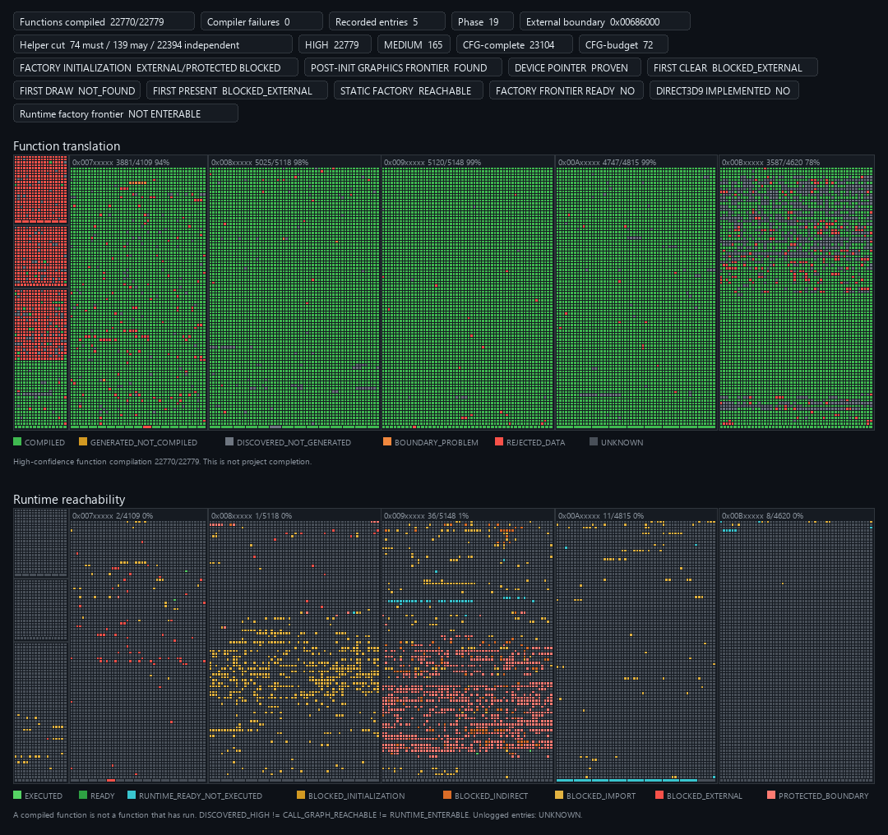

# nfsuc-web

Research fork aimed at **Need for Speed: Undercover** — take a retail `nfs.exe` you already own, lift ordinary x86 into C, and poke at what actually runs in a small native harness.

This does **not** boot the game. No browser build yet. Not affiliated with EA.

Your install stays on your machine. Tools only read it. Game binaries and generated game C never go in git.

## Progress



Top: translation/compile. Bottom: runtime. Green on the top map ≠ the game works.

```sh
python tools/progress.py
```

Roughly: ~22.7k high-confidence functions generate and compile. The harness runs real ordinary call chains (depth 3+ via constructors/initializers, math/CRT leaves). Graphics remains blocked on a protected backend; Direct3D is not implemented. Protected startup is left alone.

More detail: [docs/roadmap.md](docs/roadmap.md), [docs/feasibility.md](docs/feasibility.md), [analysis/undercover/](analysis/undercover/).

## Quick start

Python 3, `requirements.txt` (`capstone`, `pefile`). Compile checks want `clang` (`CLANG` if it’s not on `PATH`). Optional analysis oracle: `pip install "angr==10.0.5"` — not needed for build/tests/dashboard.

```sh
python tools/uc_analyze.py "C:\Games\Need For Speed Undercover\nfs.exe"
python tools/uc_code_analyze.py "C:\Games\Need For Speed Undercover\nfs.exe"
python tools/uc_gen.py "C:\Games\Need For Speed Undercover\nfs.exe" --sample-only
```

Point those paths at your own copy.

## Layout

| | |
| --- | --- |
| `tools/uc_*.py`, `tools/lift.py` | Undercover analysis / lift / generate |
| `runtime/` | Guest CPU + the tiny helpers the harness knows |
| `analysis/undercover/` | Notes and counts (no game bytes) |
| `generated/undercover/` | Local C output (gitignored) |

## Don’t commit

- `nfs.exe`, EA assets, dumps
- anything that unpacks / decrypts / bypasses protection
- generated translated game C or Wasm

## Lineage

Grew out of [nfsu2-web](https://github.com/th0mk/nfsu2-web) (Thom), itself from the MIT drop of [NFSU2Recomp](https://github.com/TalhaMudo/NFSU2Recomp). Underground 2 bits and the shared lifter are still here — see [docs/upstream-nfsu2.md](docs/upstream-nfsu2.md). Architecture notes: [docs/architecture.md](docs/architecture.md).

## License

MIT — [LICENSE](LICENSE). Copyright (c) 2026 th0mk; portions (c) 2026 Talha Müderrisoğlu.

*Need for Speed* / *Undercover* are EA trademarks.
