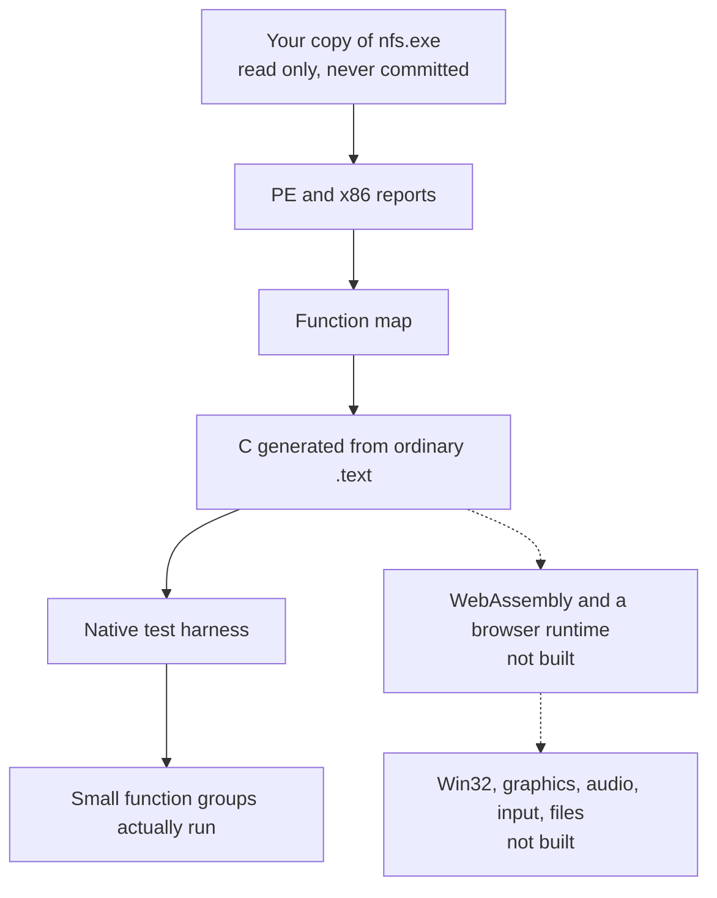

# Need for Speed Undercover, studied as code

This repository is a research project. It reads a copy of the 32-bit Windows game that **you already own**, translates ordinary machine code into C, and runs small pieces of that C in a test harness.

It does not start the game, and it does not play it. The browser build is a later goal, not something you can open today.

You keep the game on your own machine. The tools only read it. Nothing from the installation is stored in git.

Not affiliated with or endorsed by Electronic Arts.

## Where things stand

| | |
| --- | --- |
| Ordinary code translated to C | Done for the high-confidence function list. 6,598 functions generate, and all of them compile. |
| Those functions running | A native test harness runs real groups of them, including string helpers and three math helpers. The largest paths that return enter 6 functions. |
| Game startup | Out of scope. The Windows entry point sits in a protected section, and this project does not follow it. |
| Browser, graphics, sound, input | Not started. |

The current stop is ordinary program state, not missing C. One callback slot can be filled by normal game code and then called. The next object setup calls an address that is not a function. Details are in [docs/roadmap.md](docs/roadmap.md).

## What you can do here



Solid boxes exist. Dashed boxes are the direction, not a build you can run.

## Start here

You need Python 3 and the packages in [requirements.txt](requirements.txt): `capstone` and `pefile`. Compile checks look for `clang`. Set `CLANG` if it is not on your `PATH`.

Point the tools at your own install:

```sh
python tools/uc_analyze.py "C:\Games\Need For Speed Undercover\nfs.exe"
python tools/uc_code_analyze.py "C:\Games\Need For Speed Undercover\nfs.exe"
python tools/uc_gen.py "C:\Games\Need For Speed Undercover\nfs.exe" --sample-only
```

The first command describes the executable. The second describes ordinary code only. The third writes a small C sample on your machine and does not commit it.

## What never goes in this repository

- the game, `nfs.exe`, or Electronic Arts assets
- copyrighted game data
- tools that unpack, decrypt, or bypass copy protection
- generated C or WebAssembly translated from the game

Protected startup stays unread. The tools do not patch the executable or emulate that startup.

## Where to read next

| If you want… | Open |
| --- | --- |
| The short feasibility picture | [docs/feasibility.md](docs/feasibility.md) |
| How the translator and harness fit together | [docs/architecture.md](docs/architecture.md) |
| What is done and what comes after | [docs/roadmap.md](docs/roadmap.md) |
| The measurement notes | [analysis/undercover/](analysis/undercover/) |
| The original NFS Underground 2 project this tree came from | [docs/upstream-nfsu2.md](docs/upstream-nfsu2.md) |

## Repository map

| Path | Role |
| --- | --- |
| `tools/uc_analyze.py` | Read-only report of the executable. |
| `tools/uc_code_analyze.py` | Static analysis of ordinary `.text` only. |
| `tools/uc_gen.py` | Generates C for a sample or the high-confidence list. |
| `tools/lift.py` | Turns x86 into C. |
| `tools/uc_funcmap.py` | Decides which functions are safe to translate. |
| `runtime/` | Guest CPU and the small set of helpers the harness can call. |
| `analysis/undercover/` | Notes and counts. No game bytes. |
| `generated/undercover/` | Local generated C. Git ignores it. |

## Attribution

This tree started as a clone of [nfsu2-web](https://github.com/th0mk/nfsu2-web) by Thom. That project is a fork of the MIT release of [NFSU2Recomp](https://github.com/TalhaMudo/NFSU2Recomp) by Talha Müderrisoğlu (16 October 2026) and uses only code from that version. The Underground 2 browser port, its runtime, and its lifter are still here. Their README is [docs/upstream-nfsu2.md](docs/upstream-nfsu2.md).

Undercover-specific tools live beside that code. They use the same lifter. A few x86 forms were lowered so Undercover instructions can compile. The Underground 2 generator is unchanged.

## License

MIT. The copyright notice and permission text are in [LICENSE](LICENSE): copyright (c) 2026 th0mk, with portions copyright (c) 2026 Talha Müderrisoğlu. Those notices stay with the code they cover.

*Need for Speed* and *Need for Speed Undercover* are trademarks of Electronic Arts Inc.
