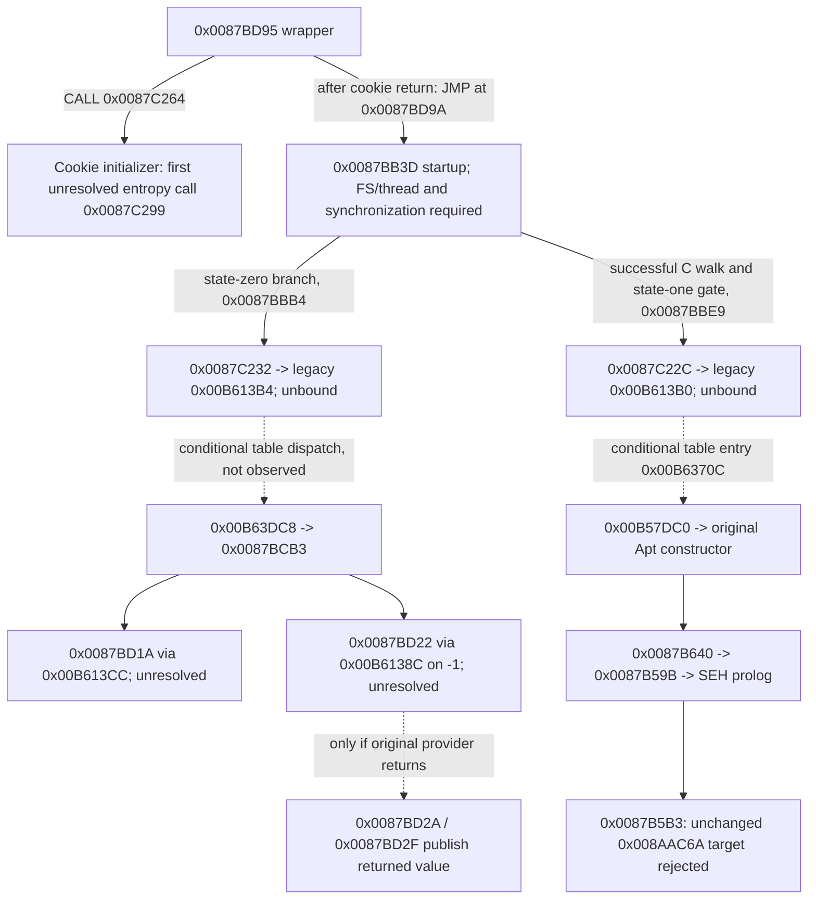

# Phase 70: MSVCR80 import identities and the unresolved legacy binding

**The active MSVCR80 import identities and conditional CRT initialization order are independently verified. No effective binding from the registrar's legacy cells to those imports is proved. The browser therefore preserves the exact 0x0087B5B3 trap.** No imported service, cookie initializer, sentinel initializer or initializer walker was executed in this phase. No callback registration succeeded.

## Baseline and preservation

Actual baseline HEAD was de308ac8, the documentation commit following Phase 69 implementation 498a4535. Main was sixteen ahead of the local origin/main reference. The same 22 pre-existing discord-bot deletions and unrelated files were preserved. No fetch or push.

Read Phase 69 report/handoff, SEH/coverage JSON, current registry/build/dispatcher/process, import inventory, actual Edge/Node traces and the external report C:/Users/999/Documents/KTA/research/undercover-phase69-provider-provenance.md, which exists and was read in full. Fresh Ghidra program information confirmed the original PE32 x86, base 0x00400000 and source SHA. Read-only cross-reference results are captured in ghidra-provider-xrefs-phase70.json.

Original nfs.exe SHA remains 6b10551649fd70fa630bd7454fd953f51555fa2dd2112faae84ac8ca97844bcd. Canonical master SHA remains f293d93d31fcbf86ad9b9639f2cf10c34defe9c621cfe7f1a5e975f598ddf88a. Canonical index SHA is e3af2649745f5b8bfa3a48e01fa3206c15148da1cc156ba5dad12184b0db6018. Master/index and original game files were not modified. No installed game or opaque loader was executed.

## Independent PE import verification

tools/uc_crt_evidence.py checks the executable SHA, parses the original import descriptor, independently decodes the import lookup table and IMAGE_IMPORT_BY_NAME strings, and compares them with pefile's import inventory. It verifies all 171 MSVCR80 entries, then records ten selected imported counterparts: the seven requested providers, both initializer walkers and the earlier pre-C provider.

Descriptor 13 is at 0x022CED83 in the import directory beginning at 0x022CEC7F. Its fields independently match:

| Field | Original RVA / value |
|---|---|
| OriginalFirstThunk | 0x01ECE91F |
| DLL name | 0x01ECCC62 → MSVCR80.dll |
| FirstThunk | 0x01ECDEF7 |
| Active IAT start | 0x022CDEF7 |
| Imported entries | 171, followed by the verified null thunk |

The descriptor, names and active import cells lie in **.securom**, not .rdata. Static section flags are read/write/execute. This section remains unavailable in the unified guest mapping. Only import metadata was read from the file; its code was not executed, reconstructed or mapped into the browser.

The legacy cells are in read-only .rdata and are not entries in the advertised active IAT. Each selected cell has a position-aligned counterpart with the same index and delta 0x0176CCC7:

| Legacy cell | Authenticated file value | Active import cell | Exact imported symbol |
|---|---|---|---|
| 0x00B61384 | 0x008AAC2E | 0x022CE04B | _unlock |
| 0x00B61388 | 0x008AAC38 | 0x022CE04F | __dllonexit |
| 0x00B6138C | 0x008AAC46 | 0x022CE053 | _encode_pointer |
| 0x00B61390 | 0x008AAC58 | 0x022CE057 | _lock |
| 0x00B61394 | 0x008AAC60 | 0x022CE05B | _onexit |
| 0x00B61398 | 0x008AAC6A | 0x022CE05F | _decode_pointer |
| 0x00B613D8 | 0x008AAD8E | 0x022CE09F | _except_handler4_common |

The two walker counterparts are 0x00B613B0 → 0x022CE077 (_initterm) and 0x00B613B4 → 0x022CE07B (_initterm_e). The earlier pre-C call uses legacy 0x00B613CC, position-aligned with 0x022CE093, whose exact imported spelling is **__set_app_type**. An initial draft used a single underscore; the independent raw-symbol comparison rejected it before evidence generation, and the spelling was corrected.

Positional alignment and compatible callsite roles support intended relationships. They do not prove copying, loader rebinding, callable live addresses or successful execution. File IAT values are name-table RVAs, not observed loader-resolved service addresses. The generated model keeps DLL/symbol identity, legacy file cell, expected caller ABI, loader-resolved service, runtime binding and execution status separate.

Microsoft's [PE specification](https://learn.microsoft.com/en-us/windows/win32/debug/pe-format) describes FirstThunk as the import-address-table destination for resolved addresses. This executable advertises that destination in the active table, not the legacy .rdata table. COFF characteristics are 0x0103 including RELOCS_STRIPPED; base-relocation, bound-import and delay-import directories all have zero RVA/size. No advertised relocation/bound/delay metadata explains replacement of the legacy values. This does not establish that an unobserved runtime writer cannot exist.

## Writer, reader and binding investigation

Fresh indexed queries show known legacy readers/indirections but no proven writer, loader copy or binding operation. The wrapper 0x0087BD95 and frontend producer 0x00810920 still have no indexed incoming references in the queried database. Indexed coverage is incomplete, as earlier recovered CRT instructions demonstrate.

A bounded .text literal search independently checks selected legacy cells, active cells, table bases and the alignment delta. Candidate instruction decodes include operand access classification, and are explicitly not promoted to trusted boundaries merely by decoding. No absolute-store candidate to the selected cells was found. Selected active IAT cells and its base have zero literal occurrences in this ordinary section. No protection-changing operation or import-copy mechanism was established.

Limits: this search cannot exclude computed writes/calls, split address calculations, unindexed paths or unavailable-region behavior. Read-only .rdata flags alone do not prove immutable native runtime contents. No opaque loader was entered to close this gap.

The actual reached original instructions are MOV ESI,[0x00B61398] at 0x0087B5AD and CALL ESI at 0x0087B5B3. There is no ordinary address transformation between them. The raw 0x008AAC6A value is inside LEA at 0x008AAC69; it remains rejected as before. Data pointer encoding by a later provider does not justify decoding or redirecting this function address. No legacy cell was overwritten, and no special redirect to _decode_pointer was introduced.

## Conditional original initialization graph

All following new relationships are **static original instruction/table evidence**, not newly executed startup. crt-initialization-order-phase70.json includes original bytes, bounded decode windows, table entries, conditional gates and first dependencies.

The wrapper's direct CALL establishes cookie-before-startup order if it is reached and the cookie routine returns. It does not connect the opaque PE entry 0x01FCA510 to that wrapper. The file cookie is the default 0xBB40E64E; that branch reaches first unresolved entropy provider [0x00B611A0] at 0x0087C299. No entropy values or alternate cookie were provided.

Startup calls the prolog with size 0x10 and scope 0x00CA93F8, outside the currently admitted registrar-specific 0x14/0x00CA9380 frame contract. It then reads FS:[0x18] at 0x0087BB4E, also outside the existing offset-zero thread fixture. The first synchronization call is at 0x0087BB62 through 0x00B611B4, with startup state/owner globals 0x018B1E58/5C. These prerequisites were recorded, not bypassed.

On the startup-state-zero branch, code sets state one and passes [0x00B63DC4,0x00B63DD4) at 0x0087BBB4 through stub 0x0087C232 to [0x00B613B4]. The four entries are zero, 0x0087BCB3, 0x0087BFE4 and 0x0087C08B; the endpoint dword is zero. A zero walker result reaches the normal continuation; nonzero goes to an error exit. The constructor gate at 0x0087BBDD requires startup state one; other states skip its call.

The constructor range [0x00B61730,0x00B63DC0) is passed at 0x0087BBE9 through stub 0x0087C22C and [0x00B613B0]. It contains 2,468 slots, 1,947 non-null file values. These are table metadata, not a count of callable or executed functions. Its first non-null entry at 0x00B61734 is 0x0087BAF2, which stages another cleanup callback and calls the same unresolved registration wrapper before the later Apt-root slot at 0x00B6370C. No host walker skips earlier dependencies to claim authentic constructor scheduling.

Microsoft documents [_initterm/_initterm_e](https://learn.microsoft.com/en-us/cpp/c-runtime-library/reference/initterm-initterm-e) as cdecl table walkers that skip nulls, with the error-returning variant able to fail initialization. That explains intended counterpart roles; the effective legacy bindings and actual traversal have not been established. No walker or CRT startup wrapper was newly admitted to the runtime registry.

## Cleanup sentinel and service contracts

Original 0x0087BCB3 begins with PE-header checks at 0x00400000, which the current guest process does not map as an ordinary section. Its normal continuation calls [0x00B613CC] at 0x0087BD1A with pending argument one, then pushes -1 at 0x0087BD20 and calls [0x00B6138C] at 0x0087BD22. After two argument pops, original stores at 0x0087BD2A/2F publish EAX to 0x018B1E68/6C.

Thus the initializer is a proved **conditional original writer**, but its execution requires PE-header support and at least the earlier legacy provider plus encoder binding. No encoded sentinel value is known. No host writes either global. In the actual browser both remain zero, and the registrar's first provider argument remains zero. The file-backed cookie and complement remain 0xBB40E64E/0x44BF19B1; cookie initialization was not executed.

crt-provider-binding-phase70.json records the requested service-contract review. Original consuming stack cleanup supports cdecl-shaped calls; that is kept distinct from independently executing/verifying the exact MSVCR80 implementation behind a resolved address. **No adapters were added.**

| Service | Independently supported contract / remaining requirement |
|---|---|
| _encode_pointer / _decode_pointer | Exact active names verified; original consumers pass one pointer-sized dword and expect EAX. The exact MSVCR80 algorithm, errors, encoding context and lifetime remain unverified. No identity transform, invented secret, encoded -1 or decoded legacy function address was supplied. |
| _onexit | [Documented](https://learn.microsoft.com/en-us/cpp/c-runtime-library/reference/onexit-onexit-m) no-argument callback registration, callback pointer on success and null on storage failure; requires owned CRT registration/lifetime state. Documentation is not a legacy-cell binding. |
| __dllonexit | [Documented](https://learn.microsoft.com/en-us/cpp/c-runtime-library/dllonexit) callback plus addresses of begin/end pointer variables, with callback pointer/null result. Actual provider allocation, capacity and guest storage/lifetime remain unavailable; no invented array was appended. |
| _lock / _unlock | [Documented _lock](https://learn.microsoft.com/en-us/cpp/c-runtime-library/lock) and [_unlock](https://learn.microsoft.com/en-us/cpp/c-runtime-library/unlock) are cdecl, take an integer lock ID and return void. Lock failure/ownership and CRT state matter; the caller's value 8 is not a license for a no-op. |
| _except_handler4_common | Exact active name and original six-dword consumer contract verified. Provider-specific EH4 validation, disposition and unwind behavior remain unsupported. It was neither invoked nor stubbed. |

The Kernel32 [EncodePointer documentation](https://learn.microsoft.com/en-us/previous-versions/bb432254(v=vs.85)) describes a process-specific encoding context. It is a different DLL/API contract and does not prove a direct implementation or binding for these CRT exports. CRT internal locks and callback storage likewise cannot be replaced by generic successful returns. No claim of complete MSVCR80 compatibility is made.

## Secondary frontend-manager investigation

Fresh original-byte decoding confirms the producer 0x00810920, global check at 0x00810941, allocation at 0x00810957 → 0x00686000 with size 0x70, constructor call at 0x00810971 → 0x008101B0, and success publication at 0x00810976 to 0x01873134. Allocation failure writes zero at 0x0081098D. The constructor still has unsupported edge 0x008101E6 → 0x0055FF30.

The fresh indexed incoming query is empty. The two recovered CRT initializer ranges contain no direct 0x00810920 entry. A bounded ordinary .text relative CALL/JMP candidate scan and literal searches across .text/.rdata/.data also found no direct manager-producer address reference. These negatives cannot exclude computed, unindexed or unavailable-region callers. No temporal edge from CRT traversal to manager creation is proved. The path was not entered with a fabricated allocator return.

## Browser/runtime result

The existing shared-process inspector now separates authenticated legacy values, active DLL/symbol metadata, unavailable import storage, unverified runtime binding, static conditional order, file-cookie provenance, zero cleanup globals, live original SEH state and incomplete callback registration. A read-only describeCrtState function observes original guest cells; it has no pointer-writing or dispatch authority. The generated import metadata is descriptive only and never registers callable targets.

Actual Edge evidence is edge-execution-phase70.json. It agrees exactly with the retained Phase 69 Node instruction sequence, dispatcher trace and registers: twelve entries across seven distinct original bodies, nine callee returns, 27 original PE-global writes. Last tagged instruction remains 0x0087B5B3, ESP=0x0300EFA8, EBP=0x0300EFE4, ESI=0x008AAC6A. The synthetic thread head remains linked at 0x0300EFD4 at the stop. Registrar, wrapper and root do not return. Independent normal-path SEH restoration fixtures remain separate.

Actual imported services executed: zero. Newly entered original CRT functions: zero. New cleanup-global writes: zero. Actual callback registrations: zero. Connected frontier advanced: no. This is the acceptable evidence-backed partial outcome specified in the task, not a successful initialization claim.

## Validation and private preview

All final checks exited 0:

| Command | Result |
|---|---|
| python tools/uc_crt_evidence.py "C:/Games/Need For Speed Undercover/nfs.exe" "C:/Users/999/Documents/KTA/research/undercover-phase69-provider-provenance.md" | Both requested JSON reports and descriptive TS metadata generated; ten selected active identities, no binding |
| python tools/uc_crt_evidence_test.py | Six passed: raw identities, metadata limits, conditional order, sentinel dependencies, manager/table limits, wrong-source rejection and unchanged source SHA |
| python tools/uc_unified_build.py "C:/Games/Need For Speed Undercover/nfs.exe" "C:/Users/999/.nfsuc-web/authorized-startup" | Passed; same fourteen reviewed bindings and byte-identical Wasm |
| web: node node_modules/typescript/bin/tsc -p . | Passed (also checked with -p web from repository) |
| web: node build.mjs | Passed |
| web: node tools/unit-tests.mjs --fast | 156 tests, 155 passed, zero failed, one skipped |
| web: node --test test/uc-crt-provider.test.mjs | Two passed: generated metadata consistency and unchanged cells/blocked execution across reset/repeat |
| Python Phase 43–51 scripts, individually | 121 passed: 52/10/8/23/8/6/5/4/5 |
| python tools/uc_startup_preflight_test.py | Three passed |
| python tools/uc_phase31_campaign.py | Expected successes and explicit blocked cases retained |
| python tools/uc_recovery_inventory.py | 8,677 recovery records; active identities added separately to import inventory; general candidates stay noncallable |
| python tools/uc_startup_preflight.py "C:/Games/Need For Speed Undercover/nfs.exe" --output analysis/undercover/startup-readiness.json | Static-order evidence added; original startup still blocked |
| python tools/progress.py; python tools/uc_progress_test.py | Dashboard consistency passed |

Browser environment: UC_BROWSER_CHANNEL=msedge, UC_BROWSER_INIT_TEST=1, UC_UNIFIED_TEST=1, UC_AUTHENTIC_ASSET_ROOT=C:/Users/999/.nfsuc-web/authorized-startup, UC_SEH_NODE_EVIDENCE pointing to the retained seh-normal-path-phase69.json, and UC_BROWSER_EVIDENCE writing edge-execution-phase70.json. All nine Phase 60 cases, arithmetic validity, normal SEH, original trace equality, authentic JPEG/silent bumper, manifest integrity and OPFS reload remain tested. The one skip is the older synthetic-logo test needing unavailable bundled Chromium; real media/runtime tests ran in Edge. Existing Phase 49 ResourceWarning remains nonfatal.

The shared Wasm remains 14,981 bytes, SHA 8d1a62e0f1347d3698c9a011bf0da415291c6054c33c0b209652064da7b71c76. Because no runtime module/descriptor/payload changed, the existing authorized private manifest remains version 69 with the same six paths. No new asset authorization, network bind, firewall change or public exposure. Local HTTPS Wasm HEAD returned 200/application/wasm with matching length. Generated modules, PE payload and commercial media stay outside Git. Full-game Play remains disabled. No legacy removal was justified.

## Readiness and next target

Verified: active import-directory ownership/identity, exact legacy file values and read-only mapping, recovered conditional CRT wrapper/order/table memberships, original sentinel store instructions and their blockers, unchanged SEH/registrar trace and fresh browser regression results.

Unverified: effective legacy-to-active binding, original writer/copy/protection transition, callable resolved service targets, exact live CRT provider state, original cookie/sentinel initialization, table traversal, cleanup registration, CRT-to-manager connection, PE-entry reachability, menu and gameplay. Historical native ledger remains 84 unique, 50 enterable and 358 recorded runs. Import/table metadata and browser reruns add no execution functions.

Phase 71 should pursue an ordinary, address-grounded producer of the legacy provider table or a verified original call path using a legitimate active import. Require the actual write/copy/destination/permissions and initialization order before binding it. If the only missing mechanism remains unavailable, report that boundary without reconstructing opaque code, redirecting 0x008AAC6A, decoding providers speculatively or seeding an encoded sentinel. Preserve the existing regression as the control.

## Local delivery

Implementation commit: 591bf1ee. Reports/evidence/dashboard are recorded in a following focused local commit. After both commits main is eighteen ahead of the unchanged local origin/main reference, with only the same 22 unrelated discord-bot deletions remaining in the worktree. Original assets, generated PE/Wasm and unrelated files were not staged. Nothing was pushed.
